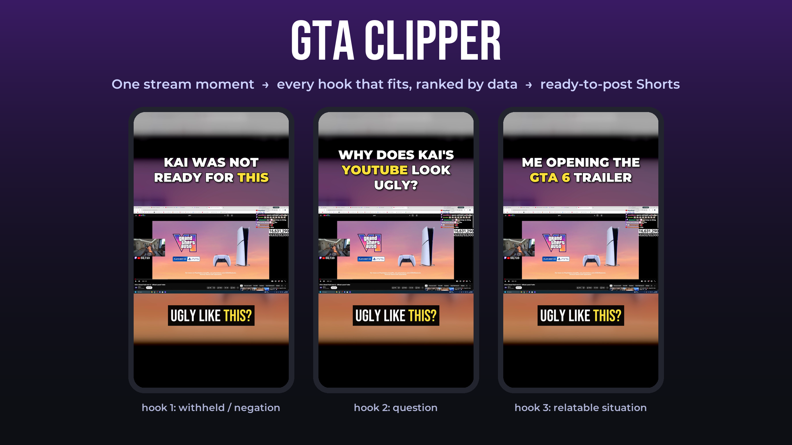
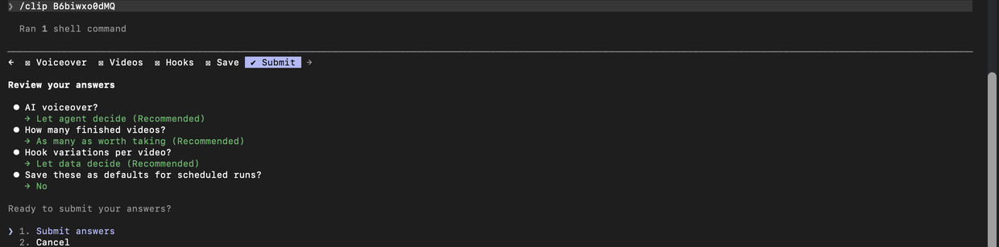
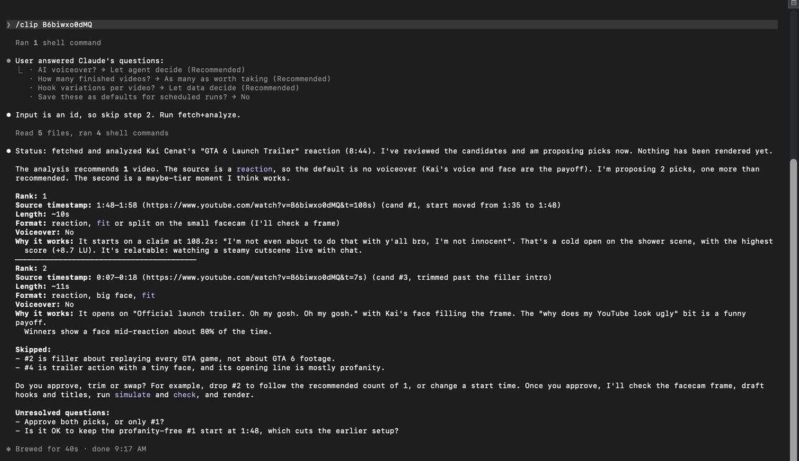
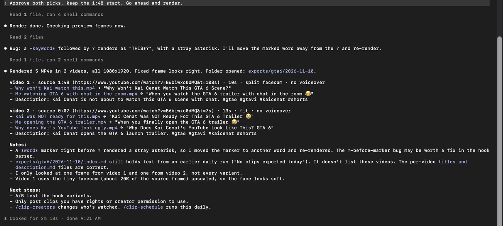

<p align="center">
  
</p>

<p align="center">
  <strong>Stop guessing hooks. Clip like the Shorts that actually went viral.</strong>
</p>

<p align="center">
  <a href="https://github.com/R3LAMP4GO/clipping-gta-6"></a>
  <a href="https://github.com/R3LAMP4GO/clipping-gta-6/actions/workflows/ci.yml"></a>
  <a href="LICENSE"></a>
  
  
  
  <a href="https://www.youtube.com/@Isaiah.Morgan"></a>
  <a href="https://www.tiktok.com/@isaiahmorgan_"></a>
  <a href="https://www.instagram.com/the_collective.exe/"></a>
  <a href="https://whop.com/opsyscollective/products"></a>
</p>

GTA Clipper turns GTA 6 streams and uploads into ready-to-post vertical Shorts. You run it from Claude Code or Codex. It finds the moments worth clipping and writes a hook for every type that fits. It ranks those hooks against what moved views on **3,481 real gaming Shorts**, then renders one captioned 9:16 MP4 per hook so you can A/B test them. And it records streams **while they're live**, so your clips are ready before other clippers have even opened the VOD.

> [!TIP]
> **Stop prompting randomly. Start building with a system.** Learn how I build tools like this one in **THE COLLECTIVE**: **[whop.com/opsyscollective/products](https://whop.com/opsyscollective/products)**

> ⭐ **If it saves you hours of scrubbing through streams, give it a star.** It's the main way other clippers find it.

## Why this clipper

- **Get the clips before anyone else.** Most clippers wait for the stream to end and scrub the VOD. This records your Twitch, Kick and YouTube creators the moment they go live on GTA 6, in gapless 30-minute chunks, and clips each finished chunk within about two hours. Your Shorts can be up while the stream is still going.
- **Hooks backed by data, not vibes.** Every hook is checked against rules from 28 GTA Shorts with 500k–51M views, then ranked by its measured effect on 3,481 gaming Shorts. Weak hooks never ship: `clipper check` fails vague ones (0.67x), bare labels (0.88x) and spoilers.
- **It finds the moments for you.** Volume jumps, screams, hype words, laughter and YouTube's most-replayed data score every second, so a 3-hour stream turns into a short list of clip candidates.
- **Runs inside your AI agent.** Claude Code or Codex does the judgment calls (which moment, which hook, which layout). Everything else runs locally and free: download, transcription, voice separation, speaker labels, captions and rendering.
- **More than one niche.** Profiles keep each niche's creators, topic filter and hashtags apart. `gta6` and `gta-rp` (NoPixel) are included.

| Hook type | Example | Views vs channel average |
| --- | --- | --- |
| **Number promise** | "4 NEW FEATURES COMING IN GTA 6" | **2.46x** |
| **Shock fact** | "HE'S 72 YEARS OLD" | **1.68x** |
| **Relatable situation** | "Me watching *GTA 6* with chat in the room" | **1.48x** |
| **Withheld / negation** | "KIDS CAN'T PLAY GTA 6" | **1.41x** |
| **Question** | "What Happens If You Shoot The Moon In GTA 6?" | **1.24x** |
| Names a streamer (adds to any type) | "Kai was NOT ready for *this*" | **1.21x** |
| Vague (blocked) | "Wait for it..." | 0.67x |

<sub>Each Short is compared with the 30 its own channel posted around it, so channel size cancels out. 19 GTA, Call of Duty, Fortnite and streamer channels, measured 9 November 2026. Full method, ranges and the 28-Short frame-by-frame study: [research/viral-gta-shorts.md](research/viral-gta-shorts.md).</sub>

## See it work

**1. `/clip` asks three quick questions** (or uses your saved defaults on a schedule):

<p align="center"></p>

**2. It proposes the moments, with timestamps and why each one works**, and waits for your OK:

<p align="center"></p>

**3. You get one MP4 per hook, plus matching titles and a description** in `exports/<profile>/<date>/`:

<p align="center"></p>

## Get started

You need **macOS or Ubuntu/Debian**, **Python 3.10+**, and **Claude Code or Codex**. Homebrew on macOS. Setup installs the rest.

**Claude Code**

```bash
git clone https://github.com/R3LAMP4GO/clipping-gta-6.git
cd clipping-gta-6
claude --model sonnet
```

Sonnet makes good picks and hooks at a fraction of Opus's usage (`/model sonnet` switches an open session; scheduled runs use it automatically). Then type `/clip-setup`. It installs FFmpeg, yt-dlp, the transcription models and the `/clip` commands (globally, so they work from any folder). Then:

```
/clip                       # scan your creators for new GTA 6 videos
/clip https://youtu.be/...  # or clip one video
```

**Codex**

```bash
git clone https://github.com/R3LAMP4GO/clipping-gta-6.git
cd clipping-gta-6
codex "Follow .codex/prompts/clip-setup.md"
```

Setup copies the prompts to `~/.codex/prompts/`. After that use `/prompts:clip`, `/prompts:clip-daily` and the rest.

## Commands

| Command | What it does |
| --- | --- |
| `/clip [url \| phrase]` | Find, review and render. Asks about voiceover, how many videos and how many hooks, then shows picks for your approval |
| `/clip-daily` | The unattended run: clips new uploads and recorded live chunks using your saved preferences |
| `/clip-schedule [HH:MM]` | Runs `/clip-daily` every day. With live streams listed, it also records them as they go live and clips the chunks every 2 hours |
| `/clip-creators [add @handle \| remove name]` | Choose which creators to watch |
| `/clip-setup` | Installs the tools, models and commands |

Pick a niche with `--profile gta-rp` (or `CLIPPER_PROFILE`). Each one lives in `profiles/<name>/`: `profile.yaml` (topic filter, hashtags, searches), `creators.yaml` and `live.yaml`. Add your own by copying a folder.

<details>
<summary><strong>CLI reference</strong> (what the agent runs for you)</summary>

```
python3 -m clipper watch                       # new on-topic uploads from the profile's creators + searches
python3 -m clipper run <url>                   # download + transcribe + score -> jobs/<id>/candidates.md
python3 -m clipper frame <id> 100              # gridded frame to locate a facecam (split layout)
python3 -m clipper voice-setup                 # save a Fish Audio key (macOS: key page + TextEdit note; Linux: hidden prompt)
python3 -m clipper creators add @KaiCenat       # or: list / remove
python3 -m clipper prefs set voice=auto videos_per_run=3 hooks_per_video=4
python3 -m clipper daily                       # new GTA 6 uploads -> analyzed jobs
python3 -m clipper schedule install --time 09:00   # CLI-only fallback scheduler
python3 -m clipper render <id> --picks picks.json   # exports/<profile>/<date>/video N/<hook>.mp4
python3 -m clipper simulate picks.json          # rank hook variants with a simulated swipe test
python3 -m clipper check picks.json --job <id>  # research rules + fail picks reusing exported footage
python3 -m clipper find "moment of truth"       # one line across every stream of the last 6 h (multi-streamer edits)
python3 -m clipper live add twitch:xqc kick:xqc youtube:@KaiCenat   # streams to record while they play GTA 6
python3 -m clipper live watch                  # start recorders for live GTA 6 streams (run every few minutes)
python3 -m clipper schedule live               # watch streams every 5 min + clip finished chunks every 2 h (/clip-daily live)
python3 -m clipper live jobs | done <job>      # finished 30-min chunks to clip / mark clipped (source kept a few hours)
python3 -m clipper bench                        # how many live creators this machine keeps up with
python3 -m clipper setup [--install]           # check/install dependencies + global /clip commands
python3 -m unittest discover -s tests
```

Creators live in `profiles/<name>/creators.yaml`, saved choices in `prefs.yaml`, topic filters in `profiles/<name>/profile.yaml`, and signal weights and clip length in `watchlist.yaml`. Output: `exports/<profile>/<date>/video N/<hook>.mp4` + `titles and description.md`, with `exports/<profile>/<date>/index.md` listing everything.

A pick is one moment (`start`/`end`) or several joined into one Short with `"segments": [{"start", "end", "job"?, "layout"?}]`: a story cut (beats of one stream) or a multi-streamer edit (the same moment from other jobs, found with `clipper find`). Every source is credited, and `upload.json` records the footage used (`footage`), the hook's simulated multiplier (`predicted`) and when the moment happened (`moment_at`), so nothing is posted twice and the best, freshest clip goes first.

Tools: yt-dlp, Parakeet (onnx-asr) or whisper.cpp, Demucs (voice separation), WhisperKit (speaker labels, macOS), FFmpeg, Pillow. Voiceover uses Fish Audio's free developer model when `FISH_API_KEY` is set (`clipper voice-setup`), otherwise the system voice. Fonts bundled in `assets/fonts` (Montserrat, Bebas Neue, TikTok Sans, Luckiest Guy; OFL/Apache licences included).

</details>

## The research

Everything the clipper decides comes from three files you can read:

- [**viral-gta-shorts.md**](research/viral-gta-shorts.md): the playbook. The four winning formats, hook and title rules, how viral clips open, hook formulas per clip type, the measured effects and how many hooks per clip to post.
- [**viral-gta-shorts-data.md**](research/viral-gta-shorts-data.md): the 28 Shorts with 500k–51M views, studied frame by frame.
- [**gaming-shorts-titles.json**](research/gaming-shorts-titles.json): 3,481 gaming Shorts (titles and views only) that `clipper simulate` uses to rank hooks.

## Learn with me

Want to build tools like this yourself? Join **THE COLLECTIVE**: **[whop.com/opsyscollective/products](https://whop.com/opsyscollective/products)**

Stop prompting randomly. Start building with a system.

Follow along: **[YouTube](https://www.youtube.com/@Isaiah.Morgan)** · **[TikTok](https://www.tiktok.com/@isaiahmorgan_)** · **[Instagram](https://www.instagram.com/the_collective.exe/)**

---

<sub>Licensed under [AGPL-3.0](LICENSE): use it, change it, build on it. If you share a changed version or run it as a service, publish your changes under the same license.<br>Only post clips you have the rights or the creator's permission to use. Many streamers welcome clippers, and some pay through clipping programs. Not affiliated with Rockstar Games, Take-Two or any streamer shown.</sub>

<p align="center">If GTA Clipper is useful to you, ⭐ star the repo so more clippers find it.</p>
